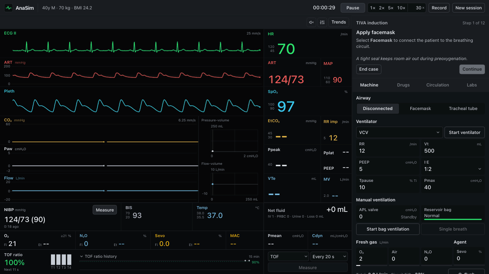

# AnaSim

AnaSim simulates adult anesthesia for education and research. It combines
published pharmacology and cardiorespiratory models with an interface for the
patient monitor and anesthesia machine.

[](https://github.com/robchiral/AnaSim/actions/workflows/ci.yml)
[](https://pypi.org/project/anasim-simulator/)
[](https://www.python.org/downloads/)
[](https://github.com/robchiral/AnaSim/blob/main/LICENSE)

[](https://robche.com/AnaSim/)



## Run AnaSim

Open [robche.com/AnaSim](https://robche.com/AnaSim/) in your browser.

To run it locally, install it with Python 3.12 or later.

```bash
python3 -m venv .venv
source .venv/bin/activate
python -m pip install anasim-simulator
anasim
```

In Windows Command Prompt, use `python` in place of `python3` and activate with
`.venv\Scripts\activate.bat`.

`anasim` opens the interface in your browser and works offline after
installation. Press Ctrl+C in the terminal to stop the server.

Choose an open simulation or a case, then select Open session and Start.
Use Apply to confirm changes to settings.

## Features

| Feature | Supported controls and measurements |
|---------|-------------------------------------|
| Patient variation | Age, body size, renal and hepatic function, coronary disease, heart failure, COPD, obesity, type 2 diabetes, baseline glucose, pregnancy with maternal positioning, and optional individual variation in drug kinetics and response |
| Anesthesia | Propofol, remifentanil, fentanyl, hydromorphone, morphine, midazolam, etomidate, ketamine, lidocaine, sevoflurane, nitrous oxide, rocuronium, succinylcholine, sugammadex, and neostigmine |
| Cardiovascular drugs | Norepinephrine, epinephrine, phenylephrine, ephedrine, vasopressin, dobutamine, milrinone, esmolol, labetalol, atropine, glycopyrrolate, and amiodarone |
| Anesthesia machine | Facemask with adjustable seal, supraglottic airway (SGA), tracheal tube, difficult-airway escalation tools and emergency front-of-neck access, fresh gas flow, vaporizer, and an adjustable pressure-limiting (APL) valve for bag ventilation and spontaneous breathing |
| Ventilation | Volume control (VCV), pressure control (PCV), pressure control with volume guarantee (PCV-VG), synchronized intermittent mandatory ventilation (SIMV), pressure support (PSV), and continuous positive airway pressure (CPAP) |
| Monitoring | ECG, pulse oximetry, arterial and noninvasive blood pressure, capnography, ventilation waveforms and loops, gas concentrations, bispectral index (BIS), train-of-four (TOF), post-tetanic count (PTC), and single-twitch monitoring, temperature, arterial and extracorporeal blood gases, activated clotting time (ACT), point-of-care blood glucose, fluid balance, trends, and alarms |
| Treatments | Fluids and blood, dextrose and regular insulin, heparin and protamine, spinal and epidural neuraxial anesthesia with bedside level checks, ECMO and cardiopulmonary bypass, chest compressions, defibrillation and synchronized cardioversion, pleural decompression, central venous air aspiration, thrombolysis, lipid emulsion, dantrolene, calcium chloride, sodium bicarbonate, fluid warming, forced-air warming, and surface cooling |
| Events | Surgical stimulation, laparoscopic CO₂ pneumoperitoneum, airway obstruction, difficult airway, esophageal intubation, bronchospasm, laryngospasm, tension pneumothorax, ARDS pulmonary shunt, arrhythmias, hemorrhage, anaphylaxis, sepsis, massive pulmonary embolism, venous air embolism, high spinal, malignant hyperthermia, lidocaine toxicity, protamine reaction, and oxygen supply failure |
| Cases | Total intravenous anesthesia (TIVA) and balanced induction, TIVA and inhalational emergence, airway and thoracic crises (failed laryngoscopy, esophageal intubation, oxygen supply failure, and tension pneumothorax), circulatory and metabolic crises (hemorrhage, anaphylaxis, septic shock, venous air embolism, massive pulmonary embolism, high spinal, malignant hyperthermia, and cardiac arrest), and extracorporeal cases (VV ECMO, VA ECMO, CPB weaning, and protamine reversal), each in guided or independent mode with a debrief |

Depending on the drug, delivery options include boluses, manual infusions, and
target-controlled infusion (TCI) to a plasma or effect-site target.

## Limits

AnaSim supports adults aged 18 to 85 years within the
[input limits](https://github.com/robchiral/AnaSim/blob/main/docs/CLI_USAGE.md#fields).
The [model guide](https://github.com/robchiral/AnaSim/blob/main/docs/MODELS.md#supported-patient-domain)
describes how the models represent patient conditions.

## Headless use

Run a 60-second simulation and save a CSV recording.

```bash
anasim --mode headless --duration 60 --record
```

## Documentation

| Task | Guide |
|------|-------|
| Configure patients, run scripts, or interpret CSV files | [CLI and Python usage](https://github.com/robchiral/AnaSim/blob/main/docs/CLI_USAGE.md) |
| Understand model behavior and assumptions | [Models](https://github.com/robchiral/AnaSim/blob/main/docs/MODELS.md) |
| Understand the code structure and step order | [Architecture](https://github.com/robchiral/AnaSim/blob/main/docs/ARCHITECTURE.md) |
| Find the source studies | [Model references](https://github.com/robchiral/AnaSim/blob/main/docs/REFERENCES.md) |
| Compare model outputs with clinical recordings | [VitalDB](https://github.com/robchiral/AnaSim/blob/main/validation/vitaldb/README.md) and [MOVER](https://github.com/robchiral/AnaSim/blob/main/validation/mover/README.md) validation |
| Change the code and choose which checks to run | [Contributing](https://github.com/robchiral/AnaSim/blob/main/CONTRIBUTING.md) |
| Review release changes | [Changelog](https://github.com/robchiral/AnaSim/blob/main/CHANGELOG.md) |

## Citation and license

To cite AnaSim, use [`CITATION.cff`](https://github.com/robchiral/AnaSim/blob/main/CITATION.cff).

AnaSim 1.6 and later use the proprietary, source-available
[AnaSim noncommercial license](https://github.com/robchiral/AnaSim/blob/main/LICENSE).

| Use | Terms |
|-----|-------|
| Individual use | Free |
| Noncommercial use at nonprofit or government institutions | Free |
| Commercial or other institutional use | Paid license |

Contact [Robert Chen](mailto:rob@robche.com) for paid licenses or written fee
waivers. The license terms allow you to share copies.
